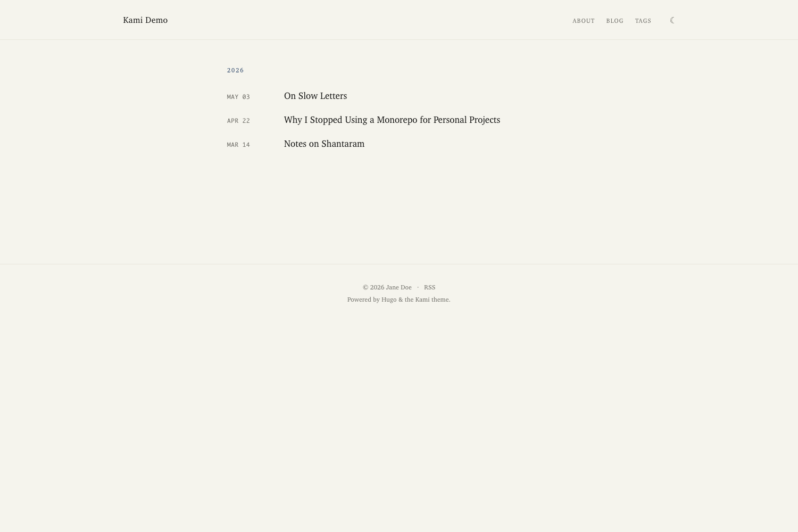

# Hugo Theme · Kami

> Editorial Hugo theme that ports [Kami](https://github.com/tw93/kami)'s warm parchment + ink-blue + serif-led print design language to the web. Built for long-form bilingual blogs.



## Features

- **Year-grouped minimal home index** — Craig Mod / Robin Sloan style date + title stream
- **Article page with right-side sticky TOC** — `IntersectionObserver`-driven active section highlight
- **Bilingual paired translations** — per-article language switcher; hides when no translation exists
- **Dark mode** — `localStorage` persistence + system preference fallback, no flash on first paint
- **Code highlighting in single-accent palette** — Chroma restyled to use only ink-blue + warm grays (no second hue)
- **Code copy button** — clipboard write with i18n labels
- **External link marker** — `↗` glyph + `target="_blank"` + `rel="noopener"`
- **Static page template** — for About / Now / Uses / etc., separate from posts
- **Tags taxonomy** — index sorted by post count; per-tag term page reuses year-grouped layout
- **Restyled footnotes** — brand-color superscripts + hairline-separated end notes
- **Tiny payload** — ~10 KB CSS bundle, ~1 KB JS bundle, no web fonts shipped

## Requirements

- Hugo extended ≥ 0.146.0

## Install

### As a Hugo Module (recommended)

In your site's `config/_default/module.toml`:

```toml
[[imports]]
  path = "github.com/mackt/hugo-theme-kami"
```

In `hugo.toml`:

```toml
theme = "hugo-theme-kami"
```

Then run `hugo mod get -u` to fetch.

### As a git submodule

```bash
git submodule add https://github.com/mackt/hugo-theme-kami.git themes/hugo-theme-kami
```

In `hugo.toml`:

```toml
theme = "hugo-theme-kami"
```

## Configuration

Minimum required:

```toml
# config/_default/hugo.toml
baseURL = "https://example.com/"
defaultContentLanguage = "zh-Hans"
theme = "hugo-theme-kami"

[outputs]
  home = ["HTML", "RSS"]

[taxonomies]
  tag = "tags"
```

```toml
# config/_default/params.toml
[author]
  name = "Your Name"
  email = "you@example.com"
```

```toml
# config/_default/menus.en.toml
[[main]]
  name = "About"
  pageRef = "about"
  weight = 5
[[main]]
  name = "Blog"
  pageRef = "/"
  weight = 10
[[main]]
  name = "Tags"
  pageRef = "tags"
  weight = 20
```

See [`exampleSite/`](exampleSite/) for a full working configuration.

## Content shape

Posts go in `content/posts/<slug>.md`:

```markdown
---
title: "Post title"
date: 2026-05-03T00:00:00+08:00
draft: false
tags: [tag-one, tag-two]
---

Body content. Standard Markdown. Footnotes supported.
```

For a translation pair, add `<slug>.<lang>.md` alongside.

Static pages (About, Now, Uses) need `type = "page"` in frontmatter and live at `content/<slug>.md`.

## Customization

The theme avoids configuration in favor of a fixed design language. The handful of dials you might want:

- **Colors / typography**: edit `assets/css/tokens.css` and rebuild
- **Site title, author, menus**: standard Hugo config
- **Add static pages** (Now, Uses): create `content/<slug>.md` with `type = "page"` and add to a menu

The intent is that you don't have to configure much — the design system is the configuration.

## Credit

This theme implements a Hugo port of the **[Kami](https://github.com/tw93/kami)** design language by [Tw93](https://github.com/tw93). The visual system — warm parchment, single ink-blue accent, serif-led hierarchy, no bold, no cool grays — is Tw93's invention; this repo just translates it into Hugo templates and CSS.

If you like the aesthetic, give Tw93 a star on the original Kami repo too.

## License

MIT. See [LICENSE](LICENSE). The license preserves Tw93's original Kami MIT notice.
